# Open a log

Choose File, then Open EVTX, and pick the log. McParser creates the case folder beside that file and reads the records into it. A Security log of a couple of thousand events takes a few seconds. A larger log takes longer. You can leave it. The window is not talking to a server.

When the read finishes, the case pane on the left fills in. You should see the path, the file name, the size, the SHA-256, the event count, the number of distinct event ids, the first and last time, the channels, and the providers. Those numbers are the check that you opened the file you meant to open. The sample Security log used in development has 2261 events. If you opened that file and the count is 2261, the read worked.

The left pane collapses. Case, Queries, and Hunts are separate lists so the column does not turn into one long scroll. Refresh case reads the folder again. Use it after you have copied a new file in, or after you have opened a handoff.

Opening the same bytes twice does not double the events. McParser hashes the file. If that hash is already in the catalog, the second open is skipped. If the path is the same and the hash has changed, the old rows for that path are replaced. A changed log is a new source, not a second copy of the old one.

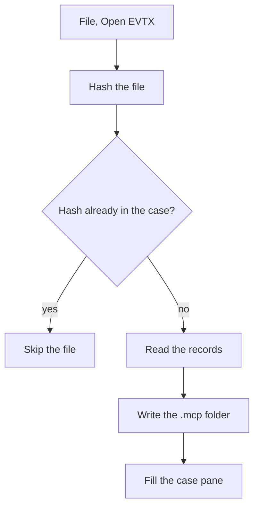

## PE view

File, Analyze PE File... opens one Windows executable or DLL and shows what its headers say. McParser only parses the file. It never runs it and makes no network calls for it. The tabs cover General, PE Header, MZ Header, Sections / Overlay, Imports / Exports / TLS, Resources, Debug, Version Info / Signature, and Hex / Strings. The hints on the General tab are hints, not verdicts.

Appearance is an app-wide setting, set in Preferences. Light, Dark, or Follow system applies to every screen: the editor, results grid, left pane, dialogs, AI pane, audit lists, and this PE view. Follow system is the default and tracks the OS light or dark setting. The choice applies immediately and is remembered between sessions.

**Preferences.** Open it with McParser > Preferences... (Cmd+,) on macOS, or File > Preferences... (Ctrl+,) on Windows and Linux. The Appearance section has the three options as a radio group: use Tab to reach it, the arrow keys to move between options, and Escape or Done to close the dialog.

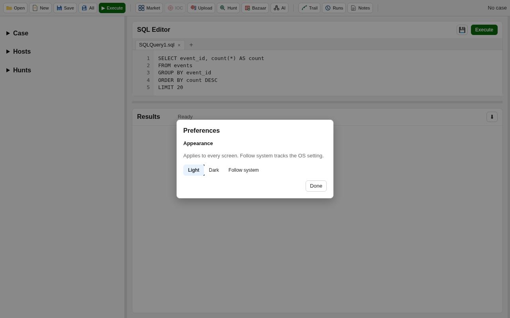
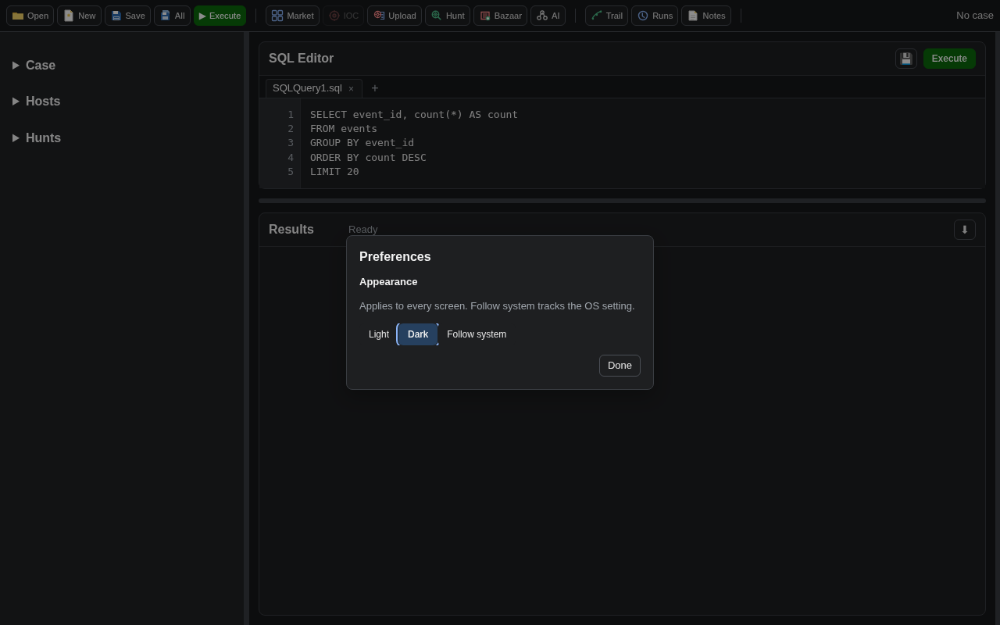

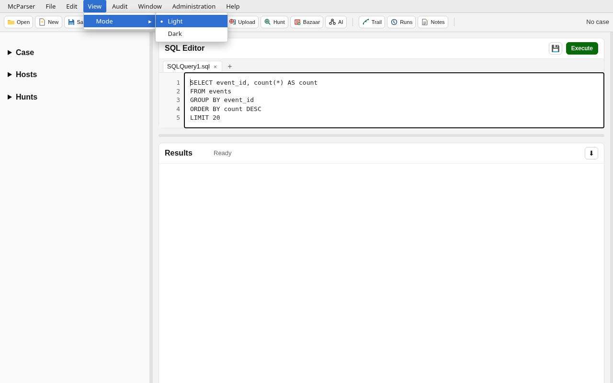
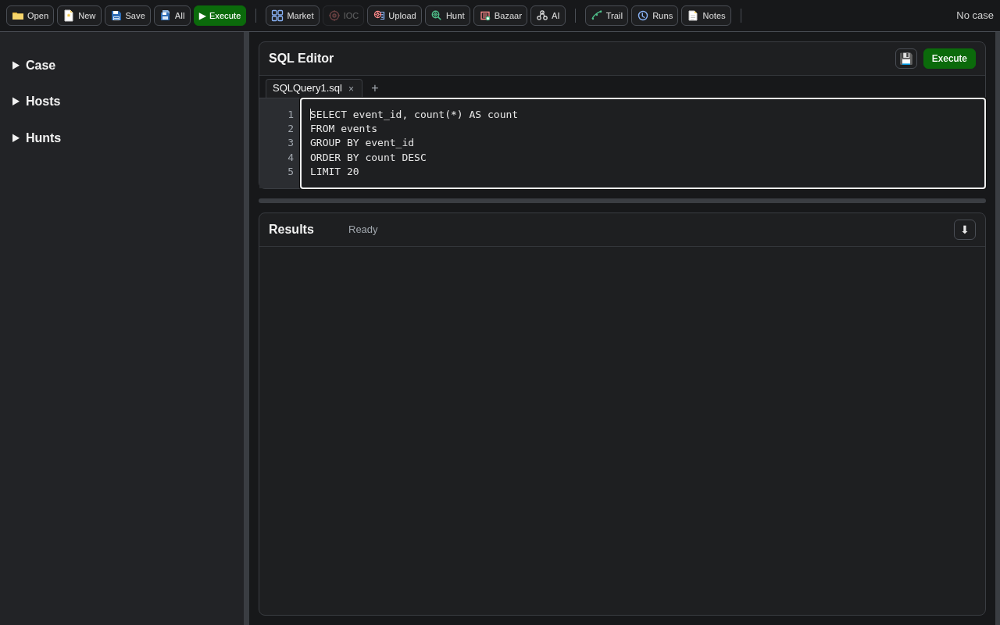

### Resources tab

The Resources tab has a tree on the left. Top-level folders are resource types (RT_ICON, RT_VERSION, RT_MANIFEST, and so on, or the numeric id for custom types). Under each type are the resource names or ids, and under those the languages. Click a language leaf, or move with the arrow keys, Home, and End, to show that resource on the right:

- Name, Type, Language (decimal, hex, and the language name when known), MD5, SHA256, Size, and Offset. The hashes have Copy buttons and the offset opens the Hex tab there.
- MalwareBazaar: hit or no hit against the local MalwareBazaar dump, looked up by the resource SHA256. It shows not checked when no dump is loaded. No network call is made.
- A hex preview of the resource bytes, read through the same paged reader as the Hex tab and capped at the first 4 KB.
- For RT_VERSION and RT_MANIFEST, the parsed text beside the hex: version strings and fixed fields, or the manifest XML shown as text.

The Tree / Icons switch above the tree swaps in the icon gallery.

The screenshots below use a synthetic sample, not a real file.

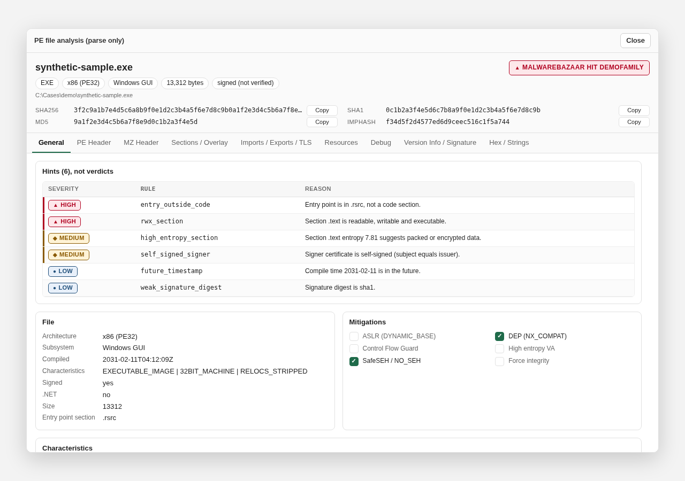
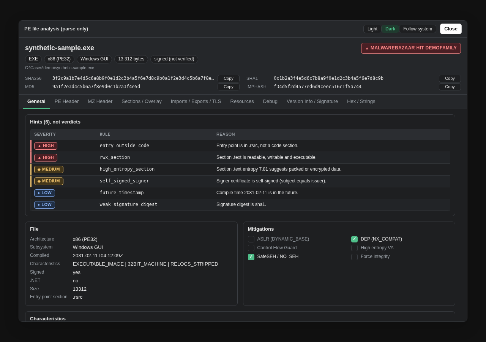
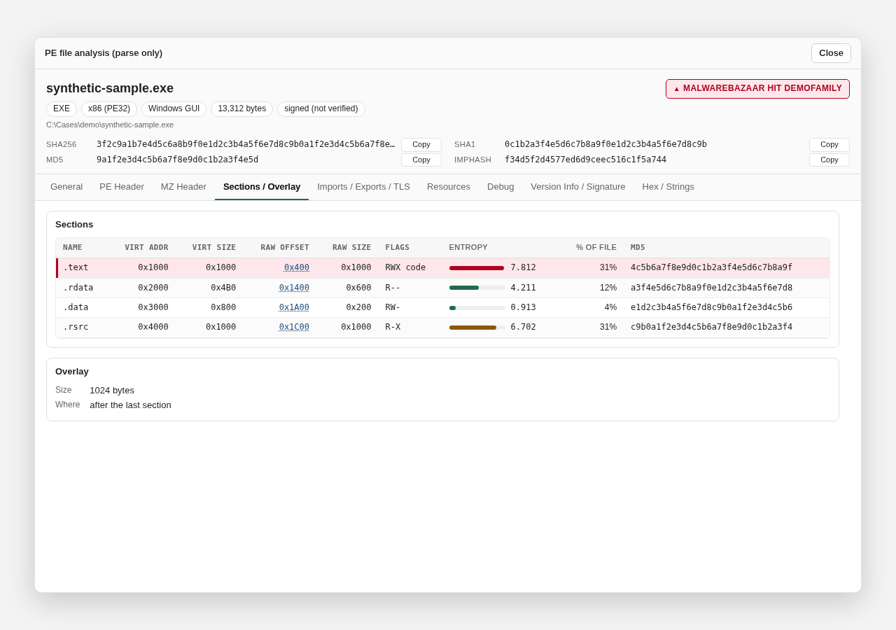
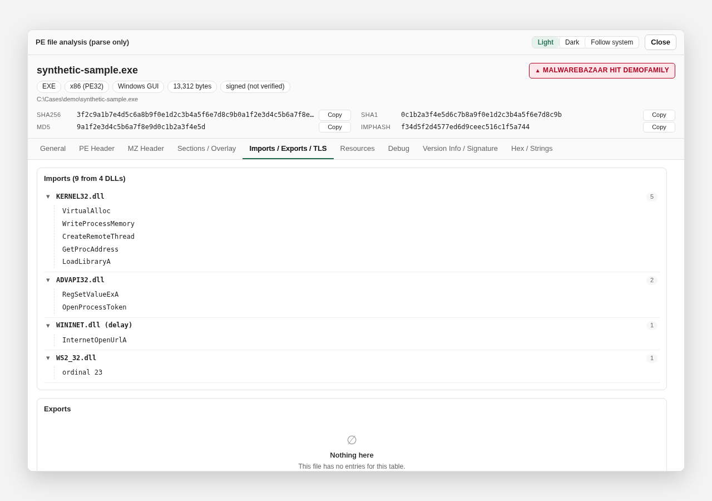
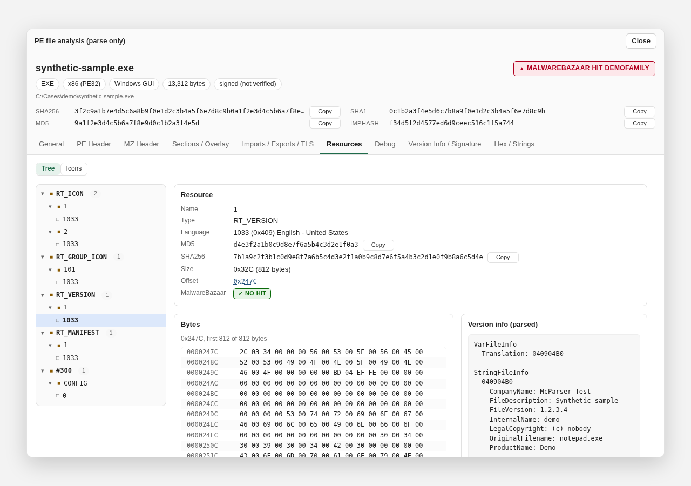
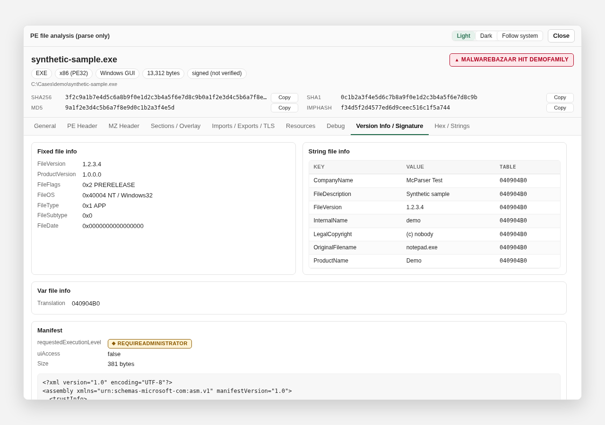
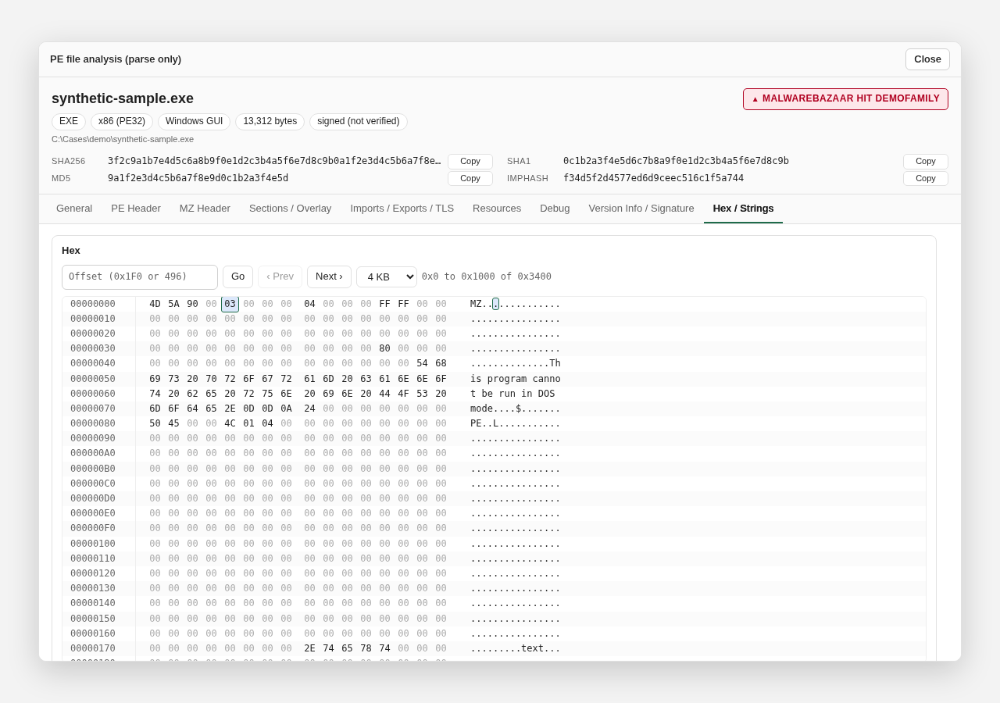
