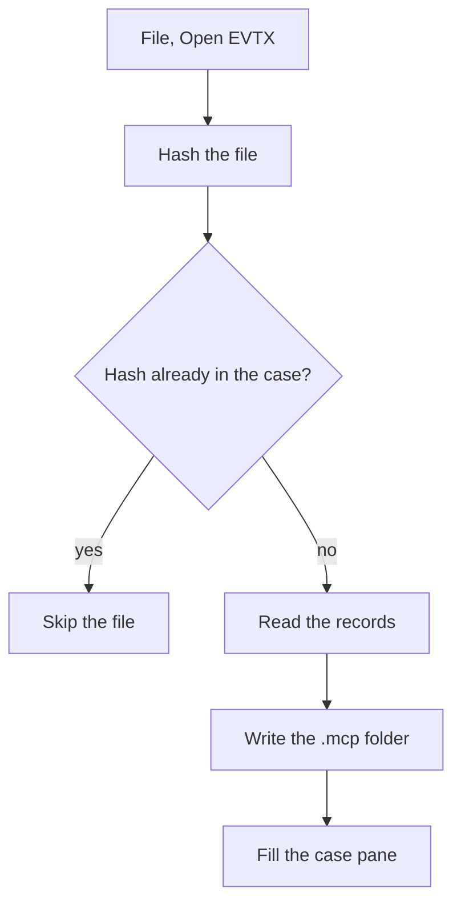
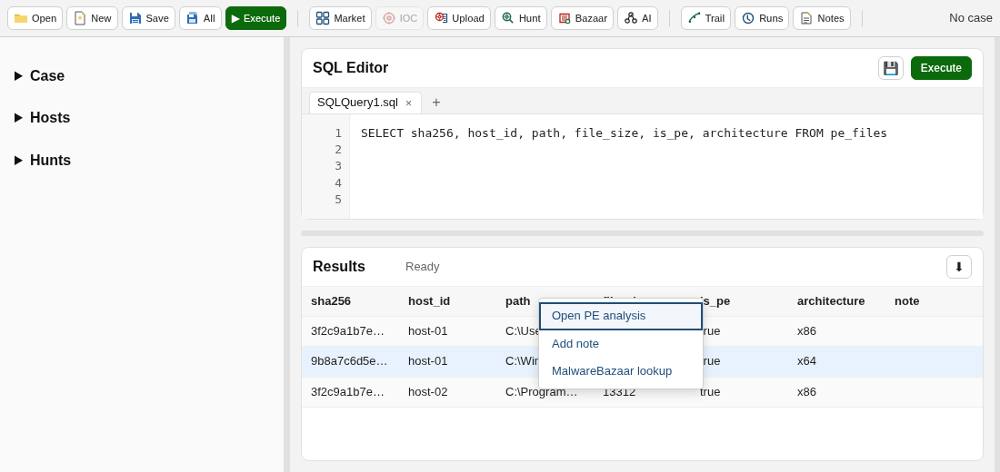
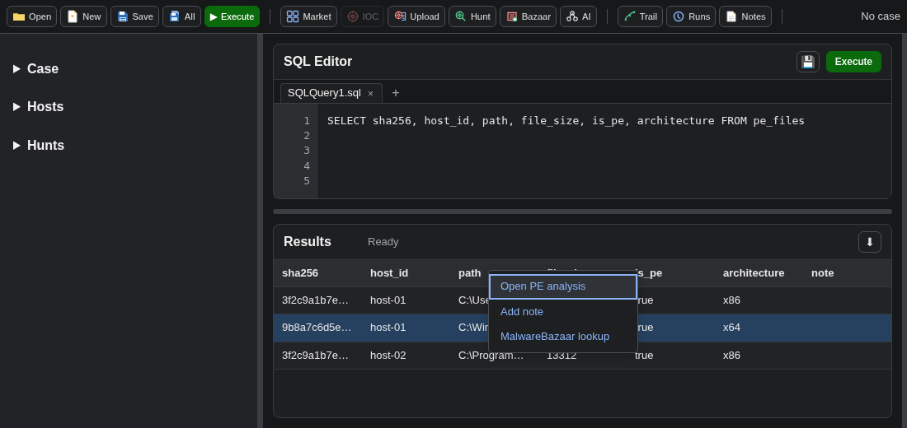

# Open a log

Choose File, then Open EVTX, and pick the log. McParser creates the case folder beside that file and reads the records into it. A Security log of a couple of thousand events takes a few seconds. A larger log takes longer. You can leave it. The window is not talking to a server.

When the read finishes, the case pane on the left fills in. You should see the path, the file name, the size, the SHA-256, the event count, the number of distinct event ids, the first and last time, the channels, and the providers. Those numbers are the check that you opened the file you meant to open. The sample Security log used in development has 2261 events. If you opened that file and the count is 2261, the read worked.

The left pane collapses. Case, Queries, and Hunts are separate lists so the column does not turn into one long scroll. Refresh case reads the folder again. Use it after you have copied a new file in, or after you have opened a handoff.

Opening the same bytes twice does not double the events. McParser hashes the file. If that hash is already in the catalog, the second open is skipped. If the path is the same and the hash has changed, the old rows for that path are replaced. A changed log is a new source, not a second copy of the old one.

## PE view

File, Analyze PE File... opens one Windows executable or DLL and shows what its headers say. McParser only parses the file. It never runs it and makes no network calls for it. The tabs cover General, PE Header, MZ Header, Sections / Overlay, Imports / Exports / TLS, Resources, Debug, Version Info / Signature, and Hex / Strings. The hints on the General tab are hints, not verdicts.

Hex / Strings also lists IOC candidates found in the strings: URLs, domains, IPv4 and IPv6 addresses, emails, registry keys, Windows paths, named pipes and user agents. They are shown defanged (`hxxp://c2[.]example[.]com/gate`, `198[.]51[.]100[.]7`) so nothing on screen is a live link. Filter by type or text, and tick Hide benign hints and private IPs to drop well-known hosts (Microsoft, W3C, certificate authorities) and private, loopback or link-local addresses. They are flagged, never removed. Version numbers such as `FileVersion 10.0.19041.1` are not reported as IP addresses. With a case open, tick rows and choose Add selected to IOC list to add them to the case IOC list for a hunt. These are hints, not verdicts: a string is not proof of a connection, and packed or encrypted files can hide their C2 addresses from plain strings. No DNS or reputation lookup is made. Ask can read the candidates too, and it writes them defanged.

If the PE view says "This McParser build does not include the PE analyzer. Rebuild with cargo build and restart.", the mcparser binary the app started is older than the PE analyzer or is missing. Rebuild it and restart the app. In development the app runs whichever of target/release/mcparser and target/debug/mcparser was built most recently.

**View > Mode.** Light or dark mode is an app-wide setting, chosen from View > Mode > Light or Dark in the app menu. It applies to every screen: the editor, results grid, left pane, dialogs, AI pane, audit lists, and this PE view. The choice applies immediately and is remembered between sessions. Until you pick one, McParser follows the OS light or dark setting, and the menu shows the mode in use as checked.

### Resources tab

The Resources tab has a tree on the left. Top-level folders are resource types (RT_ICON, RT_VERSION, RT_MANIFEST, and so on, or the numeric id for custom types). Under each type are the resource names or ids, and under those the languages. Click a language leaf, or move with the arrow keys, Home, and End, to show that resource on the right:

- Name, Type, Language (decimal, hex, and the language name when known), MD5, SHA256, Size, and Offset. The hashes have Copy buttons and the offset opens the Hex tab there.
- MalwareBazaar: hit or no hit against the local MalwareBazaar dump, looked up by the resource SHA256. It shows not checked when no dump is loaded. No network call is made.
- A hex preview of the resource bytes, read through the same paged reader as the Hex tab and capped at the first 4 KB.
- For RT_VERSION and RT_MANIFEST, the parsed text beside the hex: version strings and fixed fields, or the manifest XML shown as text.

The Tree / Icons switch above the tree swaps in the icon gallery.

### Reopen from a pe_files result

When a query result comes from the pe_files table (it has a sha256 column and a path, file_size, or is_pe column), right-click a row and choose Open PE analysis. With the keyboard, select a row, then press Shift+F10 or the Menu key; move with the arrow keys, press Enter to choose, and Escape to close. The PE view opens for that row's file, using the host_id and path in the row when the same SHA256 was saved for several hosts or paths.

The view is rebuilt from what the case already holds (pe_files, pe_sections, pe_imports, pe_exports, pe_resources, pe_indicators, pe_strings, pe_rich, pe_certificates, pe_version_info, pe_manifest, pe_icons, pe_checks, and in cases saved by newer builds pe_header_fields, pe_mitigations, pe_debug and pe_signatures). Nothing is picked, run, or loaded. With a newer case the PE Header and MZ Header tabs, mitigations, the entry point section, debug entries, signer details, resource offsets and small icons (up to 64 KiB each) come back as in the live view. The resource hex preview reads the file, so it needs the file (see below). A case saved by an earlier build has none of these: PE Header shows a short Saved in case summary, MZ Header and Mitigations say they are not saved. Analyze the file again with File > Analyze PE File to fill them.

The case does not keep the file bytes. If the saved path still exists and its SHA256 matches, the Hex tab reads it. Otherwise the Hex tab says the file is not available and offers Locate file..., which opens a file picker. The picked file is used only if its SHA256 matches the row; otherwise the Hex tab stays off and says so.

The screenshots below use a synthetic sample, not a real file.

